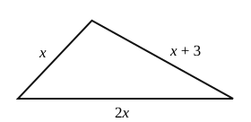

# Algebra 1 - Unit 3 Mixed Review

**Name: __________________________________________**

This review mixes every kind of problem from Unit 3.
Each part is a little harder than the part before it.
Show your work.

Some equations have **no solution** or **infinitely many solutions**.
If that happens, write it.

## Part 1

1. Solve for $x$.

   $$
   19 = 5 + 2x
   $$

2. Solve for $t$.

   $$
   d = rt
   $$

3. Solve and graph the solution on the number line.

   $$
   3n + 4 \le 13
   $$

   

   {width=90%}

4. Solve for $x$.

   $$
   14 = 2(x + 4)
   $$

5. A phone repair shop charges $\$15$ to look at a phone.
   Then it charges $\$20$ for each hour of work.
   The bill was $\$95$ in total.
   Write and solve an equation to find the number of hours.

        

6. Solve for $p$.

   $$
   7p - 2 = 22 + 4p
   $$

7. Solve for $x$.

   $$
   3(x + 2) = 3x + 5
   $$

8. The perimeter of a rectangle is $P = 2l + 2w$.
   Which equation shows this formula solved for $w$?
   Circle the correct answer.

   

   a. $w = P - 2l$
   b. $w = \dfrac{P - l}{2}$
   c. $w = \dfrac{P}{2} - l$
   d. $w = \dfrac{P}{2} - 2l$

## Part 2

9. Solve for $a$.

   $$
   P = 2a + b
   $$

10. Solve for $m$.

    $$
    2(m + 6) = 5m - 3
    $$

11. Solve for $y$.

    $$
    2(3y - 4) + 1 = 6y - 7
    $$

12. Solve for $x$.

    $$
    2 = \dfrac{x}{3} - 4
    $$

13. Solve and graph the solution on the number line.

    $$
    10 - 2z > 4
    $$

    

    {width=90%}

14. The sides of this triangle are $x$, $x + 3$, and $2x$ centimeters.
    The **perimeter** is the distance all the way around.
    The perimeter is 27 centimeters.
    Write and solve an equation to find $x$.
    Then find the length of each side.

    {width=2.3in}

    

15. Solve for $k$.

    $$
    5k - 2(k + 3) = 15
    $$

16. Lena solved $7 - 2x \ge 15$. Here is her work.

    $$
    \begin{aligned}
    7 - 2x &\ge 15 \\
    -2x &\ge 8 \\
    x &\ge -4
    \end{aligned}
    $$

    Her answer says that $x = 0$ is a solution.
    Test $x = 0$ in $7 - 2x \ge 15$. Is it true?
    What mistake did Lena make? Write the correct answer.

         

## Part 3

17. Solve for $r$.

    $$
    3(r - 4) = -2(r + 1)
    $$

18. Solve for $x$.

    $$
    y = \tfrac{1}{3}(2x - k)
    $$

19. Solve and graph the solution on the number line.

    $$
    2(x + 3) < 5x - 9
    $$

    

    {width=90%}

20. Solve for $a$.

    $$
    5a - 2(a - 1) = 3a - 2
    $$

21. Gym A charges $\$30$ to join and $\$15$ each month.
    Gym B charges $\$10$ to join and $\$20$ each month.
    Write and solve an equation to find the number of months when the two gyms cost the same.

         

22. The area of a trapezoid is $A = \dfrac{1}{2}(b_1 + b_2)h$.
    Which equation shows this formula solved for $b_2$?
    Circle the correct answer.

    

    a. $b_2 = \dfrac{2A - b_1}{h}$
    b. $b_2 = 2Ah - b_1$
    c. $b_2 = \dfrac{A}{2h} - b_1$
    d. $b_2 = \dfrac{2A}{h} - b_1$

23. You have $\$40$. You buy a pizza for $\$13$.
    Drinks cost $\$3$ each.
    Write and solve an inequality to find how many drinks you can buy.

         

24. Sam and Ana both solved $3x - 2y = 12$ for $y$.

    Sam got $y = \dfrac{3x - 12}{2}$. Ana got $y = \dfrac{3}{2}x - 6$.

    Use $x = 6$. Find $y$ with each answer.
    Then check each pair in $3x - 2y = 12$.
    Who is correct?

         
