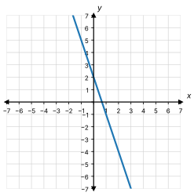
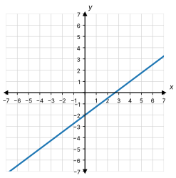
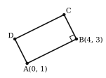

# 4.4 Writing Linear Equations - Extra Practice

**Name: __________________________________________**

Write the equation of each line in the form $y = mx + b$.
Show your work.
Each part is a little harder than the part before it.

## Part 1

1. The slope is $-5$. The $y$-intercept is $2$.

2. Write the equation of the line in the graph.

   

3. The slope is $4$. The line goes through $(2, 3)$.

4. The line goes through $(3, 2)$ and $(5, 8)$.

5. The line has slope $\dfrac{1}{2}$. It goes through $(0, -6)$.

## Part 2

6. Write the equation of the line in the graph.

   

7. $m = -4$, through $(-2, 5)$

8. The line passes through $(0, 7)$ and $(6, 3)$.

9. A line has slope $\dfrac{2}{3}$. It contains the point $(6, 1)$.

10. Through $(-4, 1)$ and $(2, -2)$

11. The table shows four points on a line.

    | $x$ | $2$ | $4$ | $6$ | $8$  |
    |:---:|:---:|:---:|:---:|:----:|
    | $y$ | $2$ | $5$ | $8$ | $11$ |

    

12. The line goes through $(-4, 3)$ and $(8, -6)$.

13. Amira wants the equation of the line with slope $-2$ that goes through $(3, -4)$.
    Here is her work.

    $$
    \begin{aligned}
    3 &= -2(-4) + b \\
    3 &= 8 + b \\
    -5 &= b
    \end{aligned}
    $$

    Her answer is $y = -2x - 5$.

    a. Check her answer. Put $x = 3$ into her equation. Do you get $y = -4$?
    b. What mistake did Amira make? Write the correct equation.

14. Diego's phone battery goes down at a steady rate.
    After $1$ hour, the battery is at $92\%$.
    After $4$ hours, it is at $68\%$.
    Let $x$ be the number of hours.
    Let $y$ be the battery percent.

    a. Write an equation for $y$.
    b. What was the battery percent at the start, when $x = 0$?

## Part 3 - Parallel and Perpendicular Lines (Optional)

15. Parallel to $y = -4x + 7$, through $(2, -3)$

16. Perpendicular to $y = 3x - 2$, through $(6, 1)$

17. The line perpendicular to $y = -\dfrac{2}{3}x + 1$ that goes through $(2, 4)$

18. The line parallel to $4x - 2y = 6$ that goes through $(-1, 4)$

19. The picture shows rectangle $ABCD$.
    In a rectangle, sides that meet at a corner are perpendicular.
    Write the equation of the line that side $BC$ is on.
    (Start with the slope of side $AB$.)

    

20. Line $p$ goes through $(-1, -2)$ and $(1, 4)$.
    Line $q$ goes through $(-3, 2)$ and $(3, 0)$.
    Are the two lines parallel, perpendicular, or neither?
    Explain how you know.
